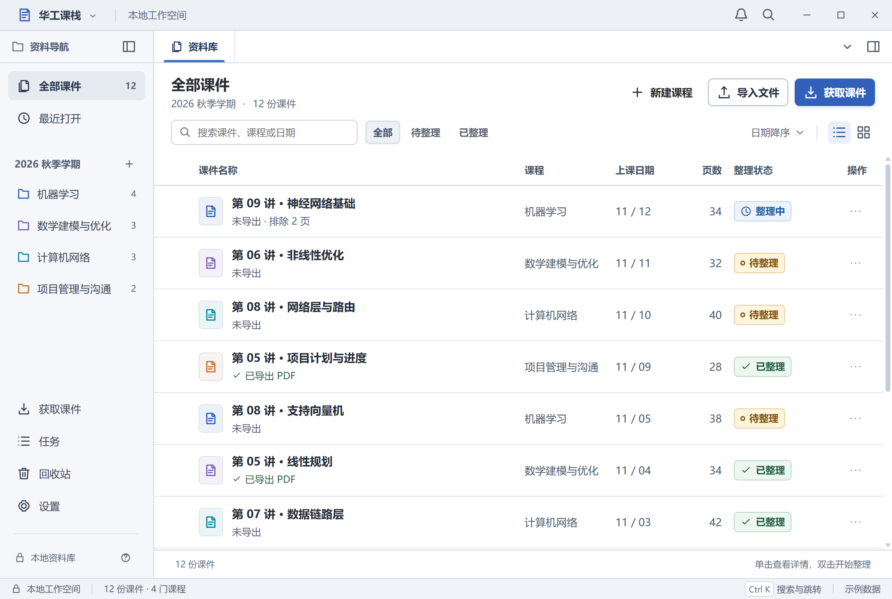
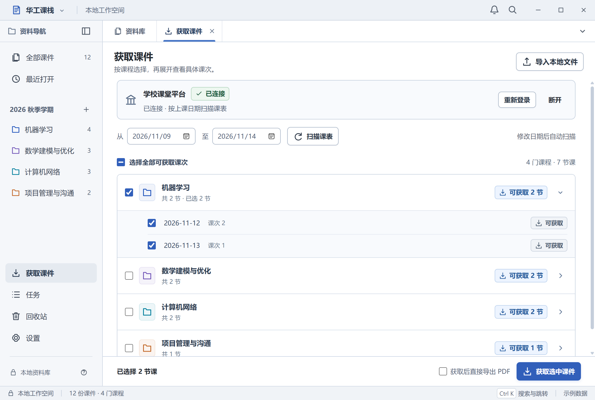
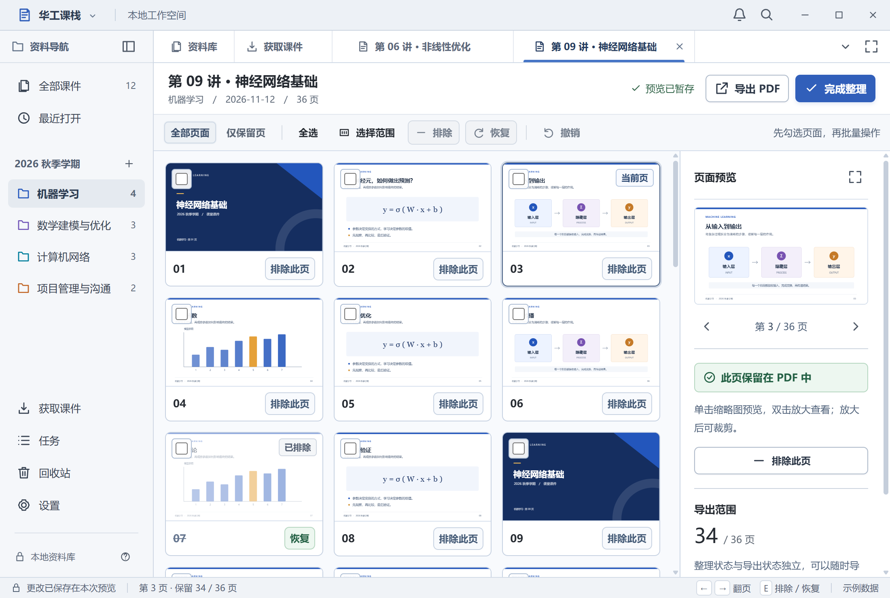
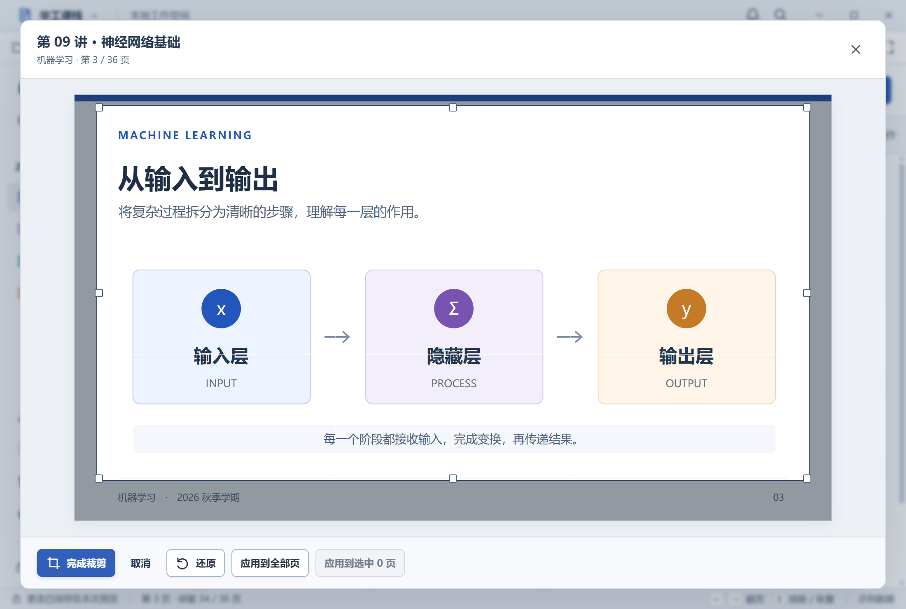

<p align="center"></p>

<h1 align="center">华工课栈 · SCUT Slides</h1>

<p align="center"><strong>给华南理工大学同学用的课堂 PPT 获取与整理工具 · Windows 桌面端</strong></p>

<p align="center">找到上过的课，收好课堂页面，整理成自己的复习资料。</p>

<p align="center">
  <a href="https://github.com/goooseby/keye-desktop/releases/latest"></a>
  
  
</p>

<p align="center"><a href="https://github.com/goooseby/keye-desktop/releases/latest"><strong>下载 Windows 安装包</strong></a> · <a href="https://github.com/goooseby/keye-android/releases/latest">Android 版</a> · <a href="https://github.com/goooseby/keye-desktop/issues">反馈问题</a></p>

---

登录学校课堂平台后，按日期扫描课表，按课程、课次批量获取课堂 PPT 页面。课件保存在本地，可以同时打开多份，逐页预览、排除无关画面、裁剪边缘，再导出 PDF。已有的图片和 PDF 也能直接导入，无需学校登录即可整理。

**获取的是学校平台记录的投影片页面，不是原始 PPT／PPTX 文件。** 内容范围以本人账号可访问、且平台实际记录的课件为准。

## 一次获取，慢慢整理

| 你要做的事 | 桌面端怎么帮你 |
| --- | --- |
| **复习前找齐课件** | 选择日期范围，扫描课表，展开课程后勾选可获取课次；已获取和获取中的内容分别提示。 |
| **在几份课件之间对照** | 多标签独立保留阅读位置、筛选、选择与滚动位置；任务在切换标签时继续运行。 |
| **删去无关页面、保留重点** | 缩略图、右侧预览和双击大图相互配合；单页或批量排除、恢复、撤销，支持按范围选择。 |
| **裁掉黑边或截图边框** | 在大图中拖出保留区域，支持还原及应用到其他页；缩略图和预览同步显示裁剪结果。 |
| **整理完导出 PDF** | 可直接导出，也可先整理再导出；单份或批量输出，应用当前保留页与裁剪范围。 |
| **管理自己的课程** | 新增课程、修改名称和学期、调整课件归属；删除课程时可将课件移至未归类或回收站，并有 8 秒撤销时间。 |

原始页面始终保留，整理结果自动保存。关闭后重新打开，可继续之前的工作；修改排除或裁剪后，可以再次导出。

## 看看现在的界面

以下截图来自当前工作台的示例模式，不含真实学校账号、个人资料或下载课件。

**资料库：课程目录与课件列表各司其职，搜索、状态筛选和行内操作就近显示。**



**获取课件：先按课程选择，再展开查看课次。**



**多标签整理：切换课件不丢进度，选页与当前页预览分开操作。**



**放大裁剪：直接在页面上调整保留区域，原始画面随时可还原。**



## 三步开始

1. **安装**：从 [Releases](https://github.com/goooseby/keye-desktop/releases/latest) 下载 `Keye_*_x64-setup.exe`，按向导完成安装。
2. **获取或导入**：在“获取课件”中登录学校平台、选择日期并获取课件；也可直接导入本地图片、PDF 或课件目录。
3. **整理与导出**：双击课件打开标签，勾选要批量处理的页面；双击某一页放大、裁剪，最后导出 PDF。

获取学校内容需要学校平台可访问。部分校外网络可能受到平台访问策略限制，可尝试校园网或学校 SSLVPN；本地课件整理与导出不依赖学校连接。

## 公告与应用内更新

标题栏的铃铛和设置中的“公告与更新”进入同一个窗口，集中查看使用提示与版本消息。支持已读、稍后提醒和重读；启动时适时提醒，每次启动最多自动展示一次，在整理课件或其他弹窗打开时暂缓出现。

版本更新仍从 GitHub Releases 获取签名安装包，校验成功后由用户选择安装。可以忽略某个版本，也可以分别关闭启动检查更新与公告提醒。更新采用完整安装包，不是二进制差分更新。

## 从“课页”升级

v0.5.0 已因窗口关闭问题撤回，请安装 v0.5.1 或后续版本。已安装 v0.5.0 的用户可通过应用内更新升级；若遇到无法退出，可先用任务管理器结束该进程，再运行新安装包。

**v0.5.0 起，Windows 端与 Android 端统一使用“华工课栈”名称。** 已安装“课页”的用户可通过原有检查更新入口升级，也可运行新安装包覆盖升级，无需先卸载或重新导入资料。

- 资料库、原始页面、裁剪与整理记录继续沿用；旧安装位置和用户自选目录不自动搬迁。
- 新界面、安装器与快捷方式使用新名称。Windows 已固定到任务栏的图标可能保留旧缓存名称，可自行取消固定后重新固定。
- 仓库名 `keye-desktop`、可执行文件和 `Keye_*` 下载文件名保留，用于兼容旧版更新与本地资料。

Windows 与 Android 同名，但各自维护本地资料，当前不提供跨设备自动同步。程序目录不存放课件数据；卸载默认保留资料，主动勾选删除时只处理默认应用数据，不删除自选资料库和已导出的 PDF。详情见 [数据保护](docs/MIGRATION.md)与[分发说明](docs/DISTRIBUTION.md)。

## 常用快捷键

| 快捷键 | 操作 |
| --- | --- |
| `Ctrl + K` | 搜索课程、课件与操作 |
| `Ctrl + Tab` / `Ctrl + Shift + Tab` | 切换工作区标签 |
| `Ctrl + W` | 关闭当前可关闭标签 |
| `←` / `→` | 翻页 |
| `E` | 排除／恢复当前页 |
| `C` / `Enter` | 进入裁剪／确认裁剪 |
| `Ctrl + Z` | 撤销页面修改 |

## 开发与维护

基于 Tauri 2、Rust、TypeScript 和系统 WebView2。Windows 环境准备见 [开发文档](docs/DEVELOPMENT.md)。项目目录内运行：

```pwsh
npm ci
pwsh -NoProfile -File .\scripts\dev.ps1
```

默认桌面入口为 `workbench.html`，界面位于 `public/workbench/`。开发资料使用项目内 `.build/dev-data/`，与安装用户的数据隔离，清理构建缓存时请保留该目录。单独用浏览器打开前端不能调用桌面业务。

[架构与模块](docs/ARCHITECTURE.md) · [工作台业务接入](docs/WORKBENCH-INTEGRATION.md) · [公告维护](docs/ANNOUNCEMENTS.md) · [版本记录](docs/releases/v0.5.1.md)
